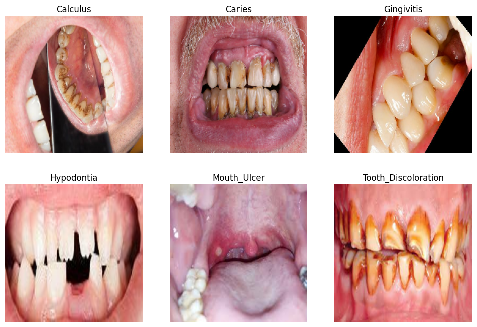
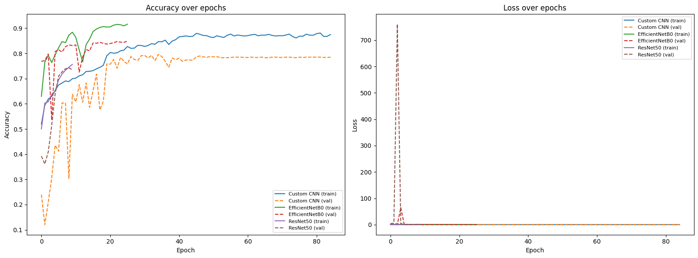
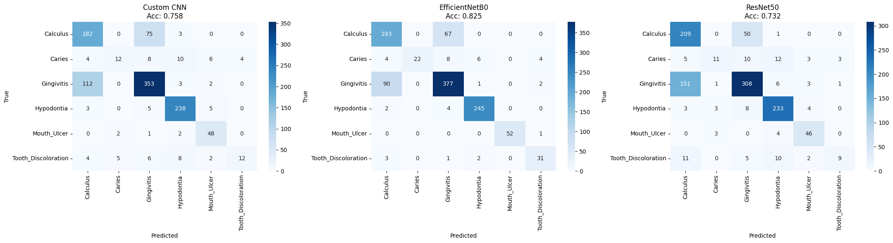
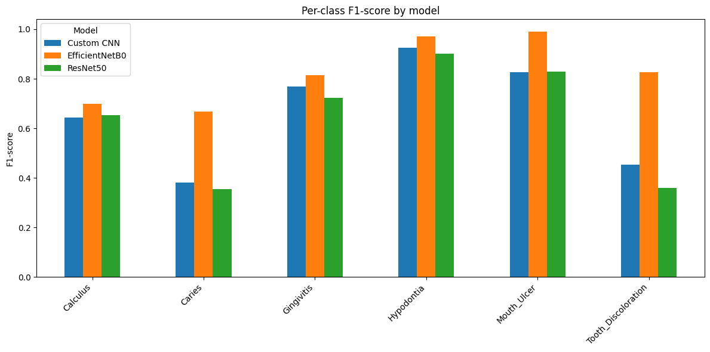
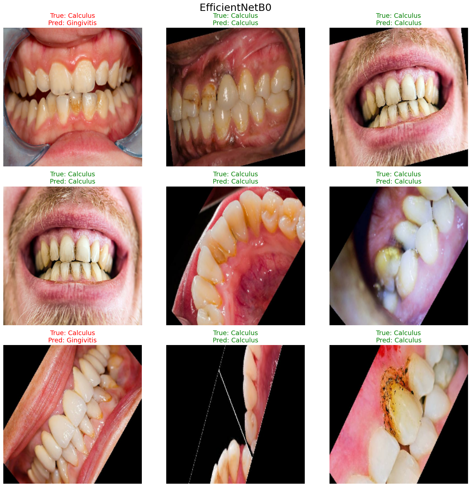

# Dentura AI — Oral Pathology Computer Vision Engine

## Overview
This component builds, compares, and deploys a deep learning system that classifies intraoral images into 6 distinct pathology categories. It covers the full pipeline: clinical data cleaning, custom CNN architecture design, transfer learning with pretrained backbones, Grad-CAM spatial interpretability, comparative evaluation, and deployment.

## Architecture Specifications
- **Champion Architecture:** EfficientNetB0 Transfer Learning with custom GlobalAveragePooling, BatchNormalization, Dropout(0.4), and Dense softmax head.
- **Trained Weights:** `best_pretrained_EfficientNetB0_model.h5` (~4.06M parameters).
- **Target Feature Map for Explainability:** `top_activation` (7×7×1280).

## Objective
Classify clinical intraoral photographic scans into 6 pathology categories with pixel-level spatial activation heatmaps for diagnostic explainability.

## Dataset & Partitions
- **Domain:** Clinical Oral Pathology Images
- **Classes (6):** Calculus, Caries, Gingivitis, Hypodontia, Mouth Ulcer, Tooth Discoloration
- **Raw structure issues:** the original dataset was not pre-split and mixed original/augmented images, plus a YOLO-annotated object-detection subset that was excluded from this classification task.
- **Cleaning process:**
  - Extracted only the *original* (non-augmented) images per class, ignoring pre-augmented folders to avoid data leakage between train/test.
  - Consolidated all classes into a clean `staging` folder (one subfolder per class).
  - Used `split-folders` to create an 80/20 train/test split (stratified per class), with validation carved out of the training set at load time (`validation_split=0.2`).
- **Class distribution (original images only):**

| Class | Images |
|---|---|
| Gingivitis | 2349 |
| Calculus | 1296 |
| Hypodontia | 1251 |
| Mouth Ulcer | 265 |
| Caries | 219 |
| Tooth Discoloration | 183 |

Note: the dataset is imbalanced — this was addressed via class-weighted considerations and discussed in the comparative analysis.

## Methodology
1. **Data loading:** `image_dataset_from_directory` (TensorFlow/Keras), batch size 32, image size 224×224.
2. **Augmentation:** random rotation, translation, horizontal flip, zoom, and contrast jitter (applied on-the-fly, not baked into cached data).
3. **Custom CNN:** a lightweight architecture using Conv2D + BatchNorm + MaxPooling blocks, `GlobalAveragePooling2D`, and a small dense head (chosen over a VGG-style Flatten+Dense(4096) design to avoid overfitting on a dataset of this size — ~457K parameters vs. ~130M).
4. **Pretrained models:** EfficientNetB0 and ResNet50, each with a custom classification head (GlobalAveragePooling2D → BatchNorm → Dropout → Dense(softmax)), using framework-correct `preprocess_input` for each backbone.
5. **Training setup:** Adam optimizer, categorical cross-entropy loss, callbacks for `ReduceLROnPlateau`, `EarlyStopping` (with `restore_best_weights`), and `ModelCheckpoint`.
6. **Limitation acknowledged:** the model has no "healthy/no disease" class — it always predicts the closest matching disease, even for a healthy or unrelated image. Low-confidence predictions are flagged in the deployment app rather than silently trusted.

## Models Compared
| Model | Type | Notes |
|---|---|---|
| Custom CNN | Built from scratch | Lightweight, GlobalAveragePooling-based |
| EfficientNetB0 | Pretrained (ImageNet) | Transfer learning, fine-tuned |
| ResNet50 | Pretrained (ImageNet) | Transfer learning, fine-tuned |

## Results

| Model | Accuracy | Precision | Recall | F1-score |
|---|---|---|---|---|
| Custom CNN | 0.7578 | 0.7602 | 0.7578 | 0.7518 |
| EfficientNetB0 | 0.8251 | 0.8330 | 0.8251 | 0.8251 |
| ResNet50 | 0.7318 | 0.7513 | 0.7318 | 0.7259 |

## Visualizations

### Sample images per class

### Training/validation accuracy & loss curves (all 3 models)

### Confusion matrices (all 3 models)

### Per-class F1-score comparison

### Sample predictions (true vs. predicted, color-coded)

## Deployment
- **Framework:** Streamlit
- **Model used:** best-performing model from comparison (EfficientNetB0, based on accuracy)
- **Features:**
  - Image upload
  - Top prediction with confidence score
  - Full probability breakdown across all 6 classes
  - Low-confidence warning banner (model has no "healthy" class, so uncertain predictions are flagged rather than stated as fact)

## Tech Stack
- TensorFlow / Keras
- EfficientNetB0, ResNet50 (`tensorflow.keras.applications`)
- scikit-learn (metrics, class weighting)
- Streamlit (deployment)
- Kaggle Notebooks (GPU training)

## Limitations & Future Work
- No "healthy" class — model always predicts one of six diseases.
- Class imbalance (183–2349 images per class) may bias performance toward majority classes.
- Source dataset merges several imaging sources with inconsistent resolution/quality, which may affect fine-detail classes.
- Future work: add a healthy/no-disease class with additional data sourcing; explore focal loss or oversampling for minority classes.
